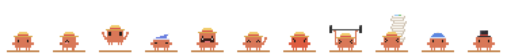

# ClawdShelf

English | [简体中文](README.zh-CN.md)

<p align="center"></p>

**A long clothesline for your screenshots, looked after by Clawd.**

On Windows, Ctrl+V only pastes your *last* screenshot. Take five, and you are back in the Screenshots folder picking them out one by one. ClawdShelf hangs your recent screenshots on a long pole across the top of the screen. Click one to copy it. Select a few and drag them into a chat or a Word document all at once.

- **Offline and tiny**: a single ~120 KB `.exe` for Windows 10/11 with .NET Framework 4.8 or 4.8.1. It uses about 70 MB of RAM and next to no CPU when idle.
- **Local screenshot storage**: screenshots saved by Windows stay in place. ClawdShelf also watches the clipboard for screenshot-like images and saves clipboard-only captures locally. It tries to merge duplicates by image similarity.
- **A temporary rack**: it holds your most recent 30 shots by default. Taking a shot off the rack never deletes the file. Delete or move the file yourself and the rack notices.
- **Out of your way**: the rack never steals focus and never closes behind your back. Clicks pass through the pole and the gaps between photos.
- **Chinese and English**: the language follows Windows.

> Inspired by Tendedero (macOS) and Clothesline (Windows). This is a separate, from-scratch project.

## Getting started

1. [Download `ClawdShelf.exe`](https://github.com/Ven0304/ClawdShelf/releases/latest/download/ClawdShelf.exe) from the [latest Release](https://github.com/Ven0304/ClawdShelf/releases/latest), or [build it](#building) yourself.
2. Run it. Clawd appears at the top centre of your screen, standing on a short rod.
3. Take a screenshot. Clawd jumps to catch it, and the pile on its back grows.
4. Click Clawd to hang them all up. Right-click → **Start with Windows**, if you like it.

## Two kinds of rack

**At home (top centre)**: a long wooden pole runs across the top of the screen (leaving the corners free for title-bar buttons), bent in the middle under Clawd's weight. The shots hang along the curve, newest right next to Clawd, spreading outwards. When it gets crowded the photos shrink and overlap (about 20 fit on one pole) and further poles hang below it.

**Away**: drag Clawd anywhere else and there are no walls to tie a pole to, so it unfolds a portable drying rack instead: straight rods with rows of shots. When Clawd sits low on the screen, the rack goes above it.

**Going home**: carry Clawd back near the top centre and the long pole lights up to show where it will land. Let go and it snaps home and hangs everything on the long pole. Right-click → **Go home** does the same.

## Click, pet, poke

| Gesture | What Clawd does |
|---|---|
| **Click** | Opens or closes the rack. Opening, it turns around, takes the pile off its back and hangs the shots up. Closing, it collects them back. Clicking anywhere else never closes the rack. |
| **Pet**: wiggle the mouse back and forth over it | It closes its eyes, blushes and puffs out hearts. Keep going and it does a shy little twirl. A sleeping Clawd just smiles and purrs in its sleep. |
| **Poke**: click it four times in two seconds | It gets cross: it turns red, stomps and steams. Keep poking and it stays cross; a calm click gets it over it and opens or closes the rack as usual. |

## Using the rack

| Do this | What happens |
|---|---|
| Click a shot | Copies the image. Your chat box keeps the focus, so press Ctrl+V right away. |
| Ctrl / Shift + click, or the circle on a photo | Selects several. The left tag also has **Select all**. |
| Drag shots out | Drag one shot, or all the selected ones, into WeChat, Slack, Word or a folder. While you drag, the rack fades and lets the drop fall through to the window underneath. |
| **Copy** in the selection bar | Copies the selected shots as files, so one Ctrl+V pastes them all. |
| Double-click a shot | Opens it in your image viewer. |
| × on a photo, or the bin on the left tag | Takes shots down. Clawd eats them and burps; the files are kept. |
| Scroll over the portable rack | Shows the other rows when there are more than three. |
| Scroll on Clawd, or on the counter tag | Changes how many shots the rack holds (5–100). Clawd lifts heavier and heavier dumbbells. |
| Ctrl + scroll on Clawd | Changes Clawd's size. |
| Drag Clawd | Lifts it off its rod (it kicks its little legs) and puts it anywhere. |
| Right-click Clawd | Menu: go home, capacity, size, hat (straw hat, beanie, top hat, none), folders, options, quit. |

### Clawd's little moods

- Blinks now and then.
- Hops to catch every new shot; the pile on its back grows taller. Close to full it starts sweating; completely full, its legs tremble.
- After 3 minutes without anything happening, it swaps its hat for a nightcap and dozes off with floating z's. The next screenshot wakes it with a start.
- Waves goodbye when you drag shots away.
- Eats the shots you take down, chews, and burps.
- Stays out of your screenshots, and hides while an app is fullscreen. Both can be turned off in the menu.

## Command line

`ClawdShelf.exe --open`: when Clawd is already running, opens or closes the rack. Put it on a shortcut and give the shortcut a hotkey.

## Settings and files

| Path | Contents |
|---|---|
| `%APPDATA%\ClawdShelf\settings.ini` | Settings. Besides what the menu offers, you can set `sleepAfterSec` and `language` (`auto`, `zh` or `en`). |
| `%APPDATA%\ClawdShelf\shelf.txt` | Which files are on the rack (paths only) |
| `%LOCALAPPDATA%\ClawdShelf\clips\` | Screenshots that only existed on the clipboard. The rack needs them while they hang on it. Right-click → **Open saved clipboard shots** to find them. |

To uninstall: turn off **Start with Windows**, quit, then delete the exe and the folders above.

## Building

```powershell
.\build.ps1
```

The build uses the `csc.exe` C# compiler that comes with Windows, so it needs no SDK, no NuGet and no internet. The output is `dist\ClawdShelf.exe`.

| File | What it does |
|---|---|
| `src/ClawdArt.cs` | Pixel Clawd: 12×8 body, 1×2 eyes, four little legs, every expression, the hats and the props |
| `src/ClawdWindow.cs` | The pet: action queue, particles, dragging, petting, poking, wheel, going home, fullscreen hiding |
| `src/RackWindow.cs` | The rack: hanging photos, the portable layout, selection, copy, drag-out, animations |
| `src/RackHome.cs` | The long bent pole at home, the "going home" glow, click-through |
| `src/Catcher.cs` | Watches the Screenshots folder and the clipboard, merges duplicates, notices deleted or renamed files |
| `src/MenuWindow.cs`, `src/BubbleWindow.cs` | Right-click menu and speech bubble |
| `tools/Preview.cs` | Renders a strip of poses to a PNG (that's `docs/clawd.png`) |

## License

[MIT](LICENSE). The license covers the code and the pixel art in this repository, not the Clawd character itself.

ClawdShelf is an unofficial fan project and is not affiliated with or endorsed by Anthropic. The Clawd character belongs to Anthropic. See [NOTICE.md](NOTICE.md).
