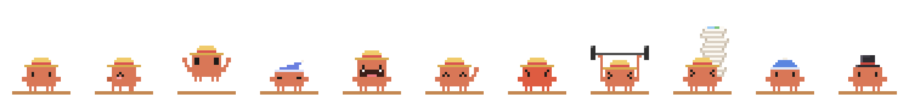

# ClawdShelf

[English](README.md) | 简体中文

<p align="center"></p>

**Clawd 帮你看着的截图晾衣杆。**

Windows 上 Ctrl+V 只能粘贴最后一张截图。截了五张，就得回 Screenshots 文件夹一张张找。ClawdShelf 把最近的截图挂在屏幕顶部的一根长晾衣杆上：点一下就复制，多选几张一起拖进微信或 Word。

- **离线、轻量**：只有一个约 120 KB 的 exe，适用于装有 .NET Framework 4.8 或 4.8.1 的 Windows 10/11。内存约 70 MB，闲置时几乎不占 CPU。
- **本地保存**：Windows 已保存的截图原地引用。ClawdShelf 也会监听剪贴板，将识别为截图的图片存到本地，并尝试按图像相似度去重。
- **临时晾衣架**：默认只挂最近 30 张。从架子上取下来不会删原图；你自己删掉或挪走了原图，架子会察觉，把它一并取下。
- **不碍事**：不抢焦点，点别处不会收起，杆子本身和照片之间的空隙都能点穿。
- **中英双语**：界面语言跟随 Windows。

> 灵感来自 macOS 上的 Tendedero 和 Windows 上的 Clothesline，ClawdShelf 是从头写的独立项目。

## 开始使用

1. 在[最新 Release](https://github.com/Ven0304/ClawdShelf/releases/latest) 中[下载 `ClawdShelf.exe`](https://github.com/Ven0304/ClawdShelf/releases/latest/download/ClawdShelf.exe)，或者[自己编译](#编译)。
2. 运行后，Clawd 会站在屏幕顶部正中的一小截杆子上。
3. 截一张图，它会跳起来接住，背上那摞又高一层。
4. 点它一下，截图就全挂出来了。觉得好用，右键 →「开机自动启动」。

## 两种晾衣架

**在家（屏幕顶部正中）**：一根长长的木杆横在屏幕顶部（两头给窗口的最小化、关闭按钮留出位置），中间被 Clawd 压得往下弯。截图沿着弯杆挂开，最新的紧挨着 Clawd，往两边排。挂多了照片会缩小、互相叠一点，一根杆子大约挂 20 张，再多就在下面再吊一根。

**出门在外**：把 Clawd 拖到别处，那里没有墙可以固定长杆，它就支起一个便携晾衣架：几层直杆，截图一排排挂着。Clawd 在屏幕下方时，架子会挂到它头顶上方。

**回家**：拎着 Clawd 靠近屏幕顶部正中，长杆会先亮起来，提示松手后会落在哪里。一松手，它就吸附回原位，把截图全挂到长杆上。右键菜单里的「回老地方」也能一键回去。

## 单击、摸摸、连戳

| 手势 | Clawd 的反应 |
|---|---|
| **单击** | 挂出或收起截图。挂出时它转身把背上那摞取下来，一张张挂好；收起时再全部收回背上。点别处永远不会收起。 |
| **摸摸**：鼠标在它身上来回晃 | 眯眼、脸红、冒爱心；摸久了害羞地转个圈。睡着时被摸不会醒，只会在梦里笑着打呼噜。 |
| **连戳**：两秒内点它四下 | 生气了：脸变红、跺脚、头上冒烟。接着戳会一直气着；停一下再点，它就「哼…好吧」消了气，照常挂出或收起截图。 |

## 晾衣架怎么用

| 操作 | 效果 |
|---|---|
| 点一张截图 | 复制这张图。光标还停在原来的聊天框里，直接 Ctrl+V。 |
| Ctrl / Shift 点击，或点照片左上角的圆圈 | 多选；左端标签里也有「全选」。 |
| 拖走截图 | 拖进微信、Word、文件夹都可以；选中了几张就一起拖走。拖动时架子会变透明，后面的窗口也能接住。 |
| 多选后点「复制」 | 以文件形式复制，一次 Ctrl+V 全部粘贴。 |
| 双击截图 | 用看图软件打开。 |
| 照片上的 ×，或左端标签的垃圾桶 | 把图取下来，让 Clawd 吃掉，它还会打个嗝；原图不删。 |
| 在便携晾衣架上滚滚轮 | 超过三排时，翻看下面几排。 |
| 在 Clawd 或右端计数牌上滚滚轮 | 调整能挂几张（5～100），Clawd 会举起越来越重的哑铃。 |
| 在 Clawd 身上按住 Ctrl 滚滚轮 | 调整 Clawd 的大小。 |
| 拖 Clawd | 把它从杆子上拎下来（会乱蹬小腿），放到任何地方。 |
| 右键 Clawd | 菜单：回老地方、容量、大小、帽子（草帽 / 毛线帽 / 礼帽 / 不戴）、打开文件夹、各种开关、退出。 |

### Clawd 的小动作

- 平时会眨眼。
- 每来一张截图都跳起来接住，背上那摞越堆越高；快满时满头大汗，满了腿都在抖。
- 闲置 3 分钟，换上睡帽打瞌睡冒 zzz；一来截图就惊醒。
- 截图被拖走时挥手送别。
- 取下来的图被它张嘴吞掉，嚼一嚼，再打个嗝。
- 默认不会出现在你的截图里，全屏看视频或玩游戏时会自己躲起来（都可以在菜单里关掉）。

## 命令行

`ClawdShelf.exe --open`：Clawd 已经在运行时，再执行这条命令会挂出或收起截图。可以给它建个快捷方式，再在快捷方式属性里设一个快捷键。

## 设置和文件

| 位置 | 内容 |
|---|---|
| `%APPDATA%\ClawdShelf\settings.ini` | 设置。除了菜单里能调的，还可以改 `sleepAfterSec`（多久打瞌睡）和 `language`（`auto` / `zh` / `en`）。 |
| `%APPDATA%\ClawdShelf\shelf.txt` | 架子上挂着哪些图（只记路径） |
| `%LOCALAPPDATA%\ClawdShelf\clips\` | 只进了剪贴板的截图。挂在架子上期间，架子要用到这些文件。右键菜单「打开剪贴板截图保存处」可以直接打开。 |

卸载：先关掉「开机自动启动」，退出程序，再删掉 exe 和上面几个目录。

## 编译

```powershell
.\build.ps1
```

用的是 Windows 自带的 `csc.exe`，不需要 SDK、NuGet，也不用联网。产物在 `dist\ClawdShelf.exe`。代码结构见[英文 README](README.md#building)。

## 许可证与声明

代码采用 [MIT](LICENSE) 许可证。许可证覆盖本仓库的代码和像素画，不包括 Clawd 这个角色本身。

ClawdShelf 是非官方的同人项目，与 Anthropic 没有关联，也未获其认可。Clawd 这个角色归 Anthropic 所有。详见 [NOTICE.md](NOTICE.md)。
